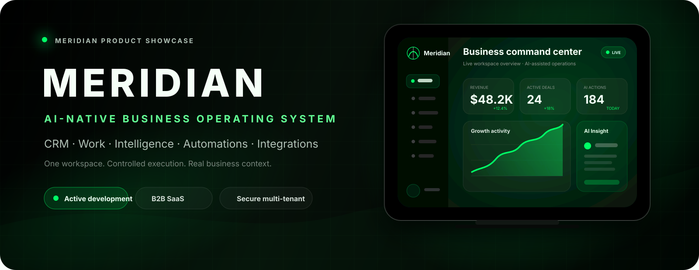

<div align="center">
  

  <br />

  [](https://meridian-completo.vercel.app)
  [](#estado-del-producto)
  [](#arquitectura)

  <h3>Un espacio operativo unificado para trabajo, clientes, datos e inteligencia artificial.</h3>

  <a href="https://meridian-completo.vercel.app"><strong>Abrir Meridian</strong></a>
  &nbsp;·&nbsp;
  <a href="https://github.com/christiandejesus320-droid"><strong>Ver fundador</strong></a>
</div>

---

## Qué es Meridian

**Meridian** es una plataforma SaaS empresarial en desarrollo que reúne productividad, CRM, operaciones, analítica, automatizaciones, integraciones y asistentes de inteligencia artificial dentro de un solo entorno.

La visión del producto es reducir la fragmentación entre herramientas y convertir la IA en una **capa operativa controlada**, capaz de trabajar con contexto, permisos y herramientas específicas sin acceder de forma indiscriminada al código, la facturación o los secretos del sistema.

> **Posicionamiento:** una interfaz central para coordinar personas, datos, flujos de trabajo y proveedores externos.

## Módulos del producto

<table>
  <tr>
    <td width="33%" valign="top">
      <h3>🧠 AI Workspace</h3>
      <p>Chat asistido, Skills, archivos, memoria contextual y enrutamiento hacia proveedores externos de IA.</p>
    </td>
    <td width="33%" valign="top">
      <h3>🤝 CRM</h3>
      <p>Contactos, oportunidades, seguimiento comercial, pipeline y contexto empresarial.</p>
    </td>
    <td width="33%" valign="top">
      <h3>✅ Trabajo</h3>
      <p>Tareas, calendario, notas, prioridades y coordinación diaria desde un mismo workspace.</p>
    </td>
  </tr>
  <tr>
    <td width="33%" valign="top">
      <h3>📊 Analítica</h3>
      <p>Indicadores operativos, actividad, uso del producto y lectura ejecutiva del negocio.</p>
    </td>
    <td width="33%" valign="top">
      <h3>⚙️ Automatizaciones</h3>
      <p>Acciones y flujos conectados a herramientas internas y servicios externos autorizados.</p>
    </td>
    <td width="33%" valign="top">
      <h3>🔌 Integraciones</h3>
      <p>Arquitectura para GitHub, Notion, Slack, Google y otros proveedores mediante APIs y OAuth.</p>
    </td>
  </tr>
</table>

## Arquitectura

<div align="center">
  
</div>

Meridian utiliza una arquitectura web moderna con separación entre interfaz, lógica de aplicación, acceso a datos y proveedores externos.

```text
Usuario
  ↓
Aplicación Next.js
  ↓
API / AI Gateway / Tools con permisos
  ↓
Prisma ORM
  ↓
PostgreSQL en Supabase
```

La plataforma se diseña como un sistema **multi-tenant**: cada operación sensible debe estar limitada por `workspaceId` para evitar cruces de información entre organizaciones.

## Stack tecnológico

<div align="center">

[](https://nextjs.org/)
[](https://react.dev/)
[](https://www.typescriptlang.org/)
[](https://tailwindcss.com/)
[](https://www.prisma.io/)
[](https://www.postgresql.org/)
[](https://supabase.com/)
[](https://vercel.com/)
[](https://www.docker.com/)

</div>

> Cada insignia es un botón real que abre la documentación o la página oficial de la tecnología.

| Capa | Tecnología | Responsabilidad | Sitio oficial |
|---|---|---|---|
| Aplicación web | Next.js + React | Interfaz, navegación, renderizado y rutas | [Next.js](https://nextjs.org/) · [React](https://react.dev/) |
| Lenguaje | TypeScript | Tipado, contratos y mantenibilidad | [typescriptlang.org](https://www.typescriptlang.org/) |
| Diseño | Tailwind CSS | Sistema visual responsive y tema OLED | [tailwindcss.com](https://tailwindcss.com/) |
| Acceso a datos | Prisma ORM | Modelos, consultas y migraciones | [prisma.io](https://www.prisma.io/) |
| Base de datos | PostgreSQL | Persistencia relacional principal | [postgresql.org](https://www.postgresql.org/) |
| Plataforma de datos | Supabase | PostgreSQL administrado y servicios asociados | [supabase.com](https://supabase.com/) |
| Despliegue | Vercel | Construcción y publicación de la aplicación web | [vercel.com](https://vercel.com/) |
| Contenedores | Docker | Entornos reproducibles y servicios locales | [docker.com](https://www.docker.com/) |
| IA | AI Gateway | Enrutamiento controlado hacia proveedores externos | Arquitectura propia de Meridian |

## Seguridad por diseño

- Separación estricta de datos por `workspaceId`.
- Claves y secretos únicamente mediante variables de entorno.
- Herramientas de IA sujetas a permisos explícitos.
- Sin acceso de la IA a billing, secretos o código fuente por defecto.
- Validación de payloads y controles antes de ejecutar acciones externas.
- Desarrollo no destructivo, revisión de cambios y capacidad de reversión.

Consulta la política del repositorio en [`SECURITY.md`](./SECURITY.md).

## Estado del producto

| Área | Estado |
|---|---|
| Interfaz principal y dashboard | 🟢 En desarrollo activo |
| CRM, tareas, notas y calendario | 🟡 Implementación y mejora continua |
| AI Workspace y AI Gateway | 🟡 Integración activa |
| Multi-tenancy y permisos | 🟡 Endurecimiento progresivo |
| Integraciones OAuth/API | 🟡 Implementación por proveedor |
| Analítica, consumo y billing | 🟡 Evolución por etapas |
| Documentación pública | 🟢 Disponible en este repositorio |

Los estados describen el avance general del producto; no constituyen una garantía de disponibilidad comercial de cada función.

## Roadmap

1. Consolidar el AI Gateway y los contratos de herramientas.
2. Completar flujos críticos de CRM, tareas, notas y calendario.
3. Reforzar aislamiento multi-tenant y pruebas de autorización.
4. Activar integraciones verificadas con OAuth y webhooks seguros.
5. Unificar medición de uso, límites y suscripciones.
6. Mejorar observabilidad, rendimiento y experiencia móvil.

El detalle está en [`docs/ROADMAP.md`](./docs/ROADMAP.md).

## Alcance de este repositorio

Este repositorio funciona como **presentación oficial del producto**. No contiene el código fuente privado de Meridian, credenciales, claves API, variables de entorno, esquemas internos sensibles ni datos de clientes.

```text
-meridian-showcase/
├── assets/
│   ├── architecture.svg
│   └── meridian-banner.svg
├── docs/
│   ├── ARCHITECTURE.md
│   └── ROADMAP.md
├── .gitignore
├── README.md
└── SECURITY.md
```

## Fundador

**Christian Junior de Jesús**  
Fundador y CEO de Meridian  
Santo Domingo, República Dominicana

<div align="center">
  <br />
  <strong>MERIDIAN</strong><br />
  Intelligent operations. Controlled execution. One workspace.
</div>
