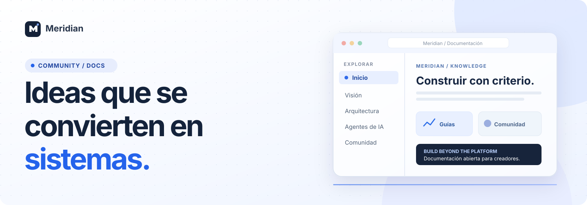
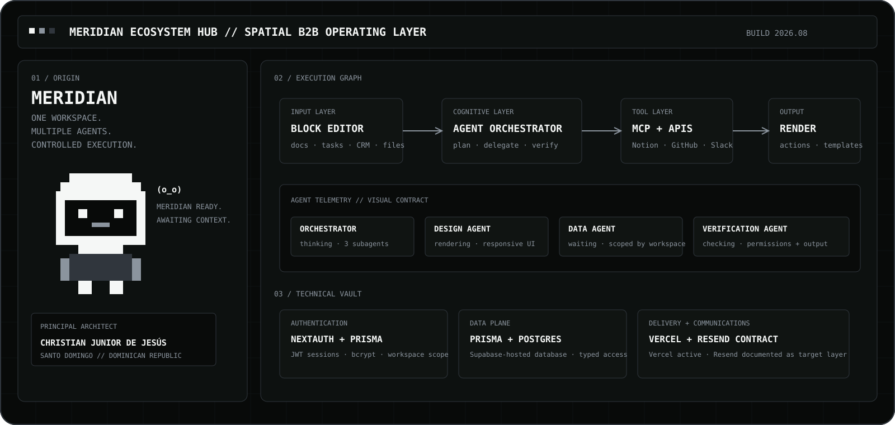
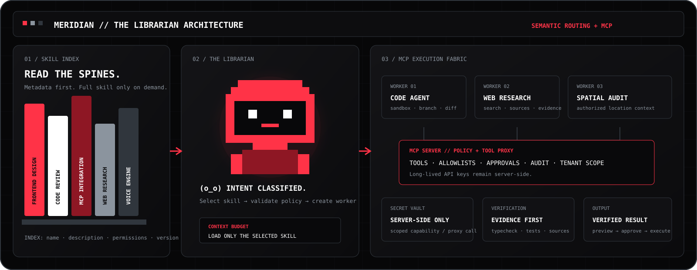

<p align="center">
  
</p>

<div align="center">

# Meridian Community

**Build beyond the platform.**

Un espacio para aprender, diseñar y compartir mejores experiencias de inteligencia artificial.

**[Explorar la web de documentación](https://christianhola.github.io/-meridian-showcase/)** · **[Comenzar aquí](./docs/GETTING-STARTED.md)** · **[Participar](./docs/community.md)**

<sub>Documentación abierta · Diseño editorial · Desarrollo asistido por IA</sub>

</div>

---

> [!NOTE]
> **Comunidad en desarrollo.** El repositorio es público y la documentación está publicada. Algunos diagramas y ejemplos ilustran propuestas o prototipos; no representan necesariamente funciones disponibles en producción.

## Descubre Meridian

Una biblioteca de ideas, documentación y herramientas para construir sistemas de IA de manera comprensible, verificable y colaborativa.

| **01 / Comienza aquí** | **02 / Arquitectura** |
| :--- | :--- |
| **[Introducción a Meridian](./docs/GETTING-STARTED.md)**<br/>Conoce el propósito del proyecto, los conceptos principales y cómo explorar sus recursos. | **[Diseño del sistema](./docs/ARCHITECTURE.md)**<br/>Explora los componentes, principios de arquitectura y flujos de agentes. |
| **03 / Inteligencia artificial** | **04 / Comunidad** |
| **[Desarrollo asistido por IA](./docs/AI-ASSISTED-DEVELOPMENT.md)**<br/>Pseudocódigo, AST, revisión humana y bucles de validación de código. | **[Construir juntos](./docs/community.md)**<br/>Propuestas, contribuciones y colaboración abierta dentro de GitHub. |

## La visión

> **La tecnología más avanzada también puede ser clara.**
>
> Meridian Community busca reunir conocimientos, ejemplos y buenas prácticas para crear herramientas inteligentes que las personas puedan entender, probar y mejorar.

**[Leer la visión completa](./docs/vision.md)** · **[Ver la hoja de ruta](./docs/ROADMAP.md)**

## Un vistazo al ecosistema

<p align="center">
  <a href="./docs/dashboard.md"></a>
</p>

| Interfaces y agentes | Conocimiento y arquitectura |
| :---: | :---: |
| [](./docs/dashboard.md) | [](./docs/SEMANTIC-ROUTING-MCP.md) |
| [**Interfaces de agentes**](./docs/INTERFACE-GUIDE.md) | [**Búsqueda semántica**](./docs/SEMANTIC-ROUTING-MCP.md) |

<sub>Las imágenes anteriores son ilustraciones conceptuales incluidas en este repositorio; no son capturas verificadas de un dashboard de producción.</sub>

## Documentación, ordenada por temas

| Aprende | Construye | Colabora |
| :--- | :--- | :--- |
| [Primeros pasos](./docs/GETTING-STARTED.md) | [Arquitectura](./docs/ARCHITECTURE.md) | [Comunidad](./docs/community.md) |
| [Pseudocódigo e IA](./docs/AI-ASSISTED-DEVELOPMENT.md) | [Runtime de agentes](./docs/AGENT-RUNTIME.md) | [Gobernanza](./docs/GOVERNANCE.md) |
| [Agentes con IA](./docs/AI-AGENT-WORKFLOW.md) | [Protocolos MCP](./docs/PLUGIN-CONTRACT.md) | [Cómo contribuir](./CONTRIBUTING.md) |
| [Guía de interfaz](./docs/INTERFACE-GUIDE.md) | [Motor de voz](./docs/MERIDIAN-VOICE-ENGINE.md) | [Código de conducta](./CODE_OF_CONDUCT.md) |

### ¿Quieres explorar como en Notion?

La **[versión web de Meridian](https://christianhola.github.io/-meridian-showcase/)** reúne el mismo contenido en páginas con navegación lateral, búsqueda y tema claro/oscuro. La portada que estás viendo aquí se muestra automáticamente **dentro del propio repositorio GitHub**.

## Participa en Meridian

¿Encontraste un error o tienes una idea? Puedes colaborar directamente en GitHub, sin otras cuentas.

**[Proponer una idea](https://github.com/christianhola/-meridian-showcase/issues/new/choose)** · **[Ver propuestas](https://github.com/christianhola/-meridian-showcase/issues)** · **[Enviar cambios](https://github.com/christianhola/-meridian-showcase/pulls)**

> [!IMPORTANT]
> No publiques credenciales, claves API, datos privados ni información confidencial en contribuciones, ejemplos o capturas.

---

<details>
<summary><b>Para desarrolladores: ejecutar, probar y consultar la estructura técnica</b></summary>

### Documentación local con VitePress

```bash
npm install
npm run docs:dev
npm run docs:build
```

### Portal React existente

```bash
npm install
npm run check
npm run test
npm run security:check
npm run build
npm run dev
```

### Ejemplos locales

El repositorio incluye ejemplos reproducibles. No requieren credenciales para los modos de demostración.

```bash
node --test examples/agent-response-starter/test/*.test.mjs
node examples/agent-response-starter/server.mjs
```

Para los contratos, requisitos, dependencias y otros comandos, consulta **[la referencia técnica completa](./REPOSITORY-REFERENCE.md)** y los documentos de la carpeta [`docs/`](./docs/).

</details>

<details>
<summary><b>Licencia, seguridad y estado de publicación</b></summary>

- **[Licencia MIT](./LICENSE):** revisa los términos antes de reutilizar el código.
- **[Marcas](./TRADEMARKS.md):** la licencia del código no implica derechos sobre marcas y logos.
- **[Seguridad](./SECURITY.md):** informa de vulnerabilidades mediante los mecanismos indicados, no en issues públicos.
- **[Estado de lanzamiento](./docs/LAUNCH-READINESS.md):** consulta los elementos pendientes y la distinción entre propuestas y funciones verificadas.
- El backend privado de Meridian y sus credenciales no forman parte de este repositorio.

</details>

---

<p align="center">
  <strong>MERIDIAN · COMMUNITY & DOCUMENTATION</strong><br/>
  Construir. Aprender. Compartir.<br/><br/>
  <a href="https://christianhola.github.io/-meridian-showcase/">Documentación web</a> ·
  <a href="./docs/community.md">Comunidad</a> ·
  <a href="./docs/vision.md">Visión</a>
</p>
