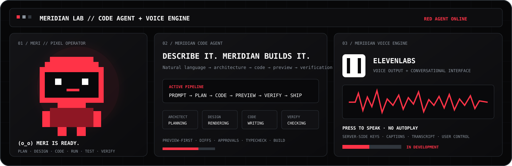
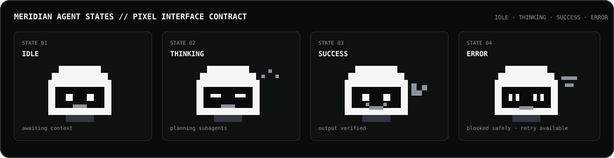
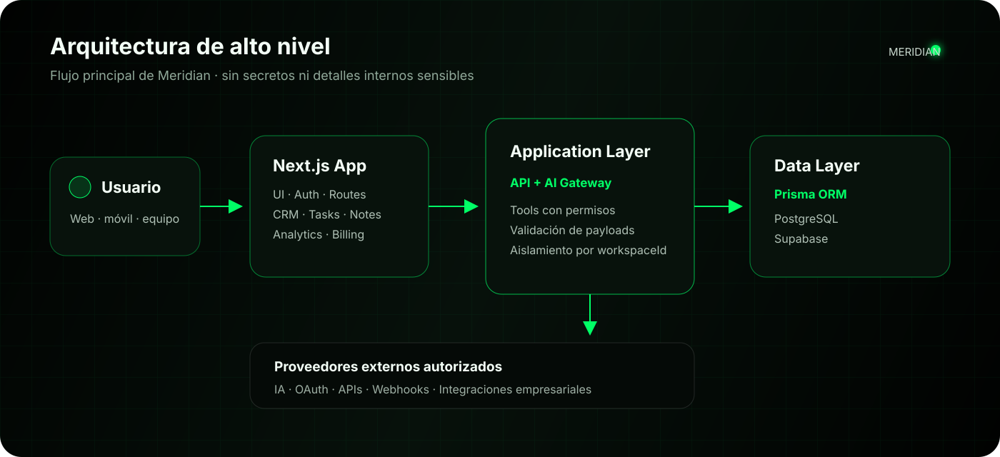

<div align="center">
  

  <br />

  [](https://meridian-completo.vercel.app)
  [](https://github.com/christiandejesus320-droid)
  [](https://github.com/christiandejesus320-droid/Meridian-Design-2v1)
  [](./docs/MERIDIAN-CODE-AGENT.md)
  [](./docs/MERIDIAN-VOICE-ENGINE.md)

  <h3>Contexto empresarial convertido en decisiones, agentes, herramientas y ejecución controlada.</h3>
</div>

---

## `meridian-start()`

```text
christian@meridian:~$ meridian start

  (o_o)   Meridian está listo.
  /|_|\   Contexto conectado.
   / \    Agentes en espera.

[workspace]  online
[agents]     ready
[tools]      permission-gated
[execution]  preview-first
```

---

## 01 / EL ORIGEN

**Meridian** se está construyendo como un **sistema operativo espacial B2B**: una capa unificada para trabajo, clientes, conocimiento, datos, automatización e inteligencia artificial.

Su núcleo combina una experiencia basada en bloques —`Notion-Core` como principio de información conectable, no como copia visual— con agentes especializados capaces de interpretar contexto, preparar planes, utilizar herramientas autorizadas y producir resultados verificables.

> **Meridian no busca ser otro dashboard con IA. Busca convertirse en la capa operativa que conecta intención, contexto y ejecución.**

<table>
  <tr>
    <td width="50%" valign="top">
      <h3>PRODUCT SYSTEM</h3>
      <p>AI Workspace, CRM, tareas, notas, calendario, analítica, Skills, integraciones y operaciones de equipo dentro de un solo workspace.</p>
    </td>
    <td width="50%" valign="top">
      <h3>PRINCIPAL ARCHITECT</h3>
      <p><strong>Christian Junior de Jesús</strong> dirige la visión del producto, la arquitectura, la dirección creativa y la evolución del ecosistema desde Santo Domingo, República Dominicana.</p>
      <a href="https://github.com/christiandejesus320-droid"><strong>INSPECCIONAR PERFIL →</strong></a>
    </td>
  </tr>
</table>

---

## 02 / ARQUITECTURA DE IA Y TAREAS

```text
USER INTENT
    ↓
BLOCK EDITOR / CHAT / TASK / CRM EVENT
    ↓
PRIMARY ORCHESTRATOR
    ├─ selects context
    ├─ validates tenant scope
    ├─ builds execution graph
    └─ delegates specialized work
            ↓
SPECIALIZED AGENTS
    ├─ design
    ├─ research
    ├─ CRM
    ├─ data
    └─ verification
            ↓
MCP / API TOOLS WITH ALLOWLISTS
            ↓
PREVIEW → APPROVAL → VERIFIED OUTPUT
```

La dirección del sistema es **preview-first**: las operaciones de lectura pueden ejecutarse dentro de sus permisos; las escrituras sensibles deben mostrar evidencia, alcance y aprobación antes de producir un efecto externo.

### Estados visuales de los agentes

<div align="center">
  
</div>

Estos estados constituyen un **contrato visual preparado para telemetría en tiempo real**. La documentación pública no afirma que el README reciba eventos live actualmente; esa conexión requiere un stream autenticado desde el runtime.

```tsx
export type AgentStatus =
  | "idle"
  | "thinking"
  | "running"
  | "success"
  | "error"
  | "approval_required";

export function MascotAssistant({ status }: { status: AgentStatus }) {
  return (
    <section data-agent-status={status} aria-live="polite">
      <PixelMascot status={status} />
      <AgentStatusCopy status={status} />
    </section>
  );
}
```

Consulta el contrato completo en [`docs/AGENT-RUNTIME.md`](./docs/AGENT-RUNTIME.md).

---

## 03 / MERIDIAN CODE AGENT

> **Estado:** arquitectura y experiencia en desarrollo. La descripción representa el producto objetivo y no presenta capacidades futuras como disponibles actualmente.

**Meridian Code Agent** será un entorno de ingeniería asistida que convierte lenguaje natural, documentos y referencias visuales en aplicaciones verificables.

No estará limitado a devolver código en el chat. Su experiencia central reunirá árbol de archivos, editor, vista de diferencias, preview desktop/tablet/móvil, consola, tareas del agente y una mascota roja conectada al estado real del runtime.

```text
DESCRIBE → PLAN → DESIGN → CODE → PREVIEW → VERIFY → SHIP
```

<table>
  <tr>
    <td width="25%" valign="top"><strong>PLAN</strong><br /><br />Inspección de repositorio, stack, riesgos, dependencias y archivos afectados sin modificar nada.</td>
    <td width="25%" valign="top"><strong>AGENT</strong><br /><br />Ejecución de un plan aprobado con cambios multiarquivo, diffs y resumen verificable.</td>
    <td width="25%" valign="top"><strong>DESIGN</strong><br /><br />Referencias visuales, tokens, responsive, accesibilidad, motion y componentes reutilizables.</td>
    <td width="25%" valign="top"><strong>DEBUG</strong><br /><br />Reproducción del error, causa raíz, corrección mínima y regresión.</td>
  </tr>
</table>

### Red especializada

```text
ARCHITECT
    ↓
DESIGN + FRONTEND + BACKEND
    ↓
SECURITY REVIEW
    ↓
TYPECHECK + LINT + BUILD
    ↓
VISUAL VERIFICATION
    ↓
USER APPROVAL
```

Agentes previstos:

- `architect`;
- `designEngineer`;
- `frontendEngineer`;
- `backendEngineer`;
- `securityReviewer`;
- `testEngineer`;
- `visualVerifier`.

**MERI**, la mascota pixel art roja, representará estados reales como `listening`, `planning`, `coding`, `running`, `testing`, `approval_required`, `success` y `error`. El producto no mostrará actividad falsa.

Documentación completa: [`docs/MERIDIAN-CODE-AGENT.md`](./docs/MERIDIAN-CODE-AGENT.md).

---

## 04 / MERIDIAN VOICE ENGINE

> **Estado:** sistema de voz con ElevenLabs en desarrollo.

**Meridian Voice Engine** será la capa de voz del ecosistema. Permitirá escuchar mensajes extensos, dictar texto, conversar con Meridian y seguir el progreso real del Code Agent sin depender únicamente de la lectura.

<div align="center">

[](https://elevenlabs.io/)

</div>

```text
USER ACTION
    ↓
MICROPHONE / PLAY BUTTON
    ↓
MERIDIAN SERVER ROUTE
    ↓
ELEVENLABS
    ↓
AUDIO STREAM + CAPTIONS + TRANSCRIPT
```

Principios obligatorios:

- reproducción solo después de una acción del usuario;
- **sin autoplay**;
- botón de voz por mensaje;
- pausa, detener e interrupción inmediata;
- texto y subtítulos visibles;
- API key únicamente en servidor;
- fallback textual;
- límites por usuario o workspace;
- sin almacenamiento de audio por defecto.

MERI mostrará estados de voz como `listening`, `transcribing`, `thinking`, `speaking`, `paused`, `success` y `error`.

Documentación completa: [`docs/MERIDIAN-VOICE-ENGINE.md`](./docs/MERIDIAN-VOICE-ENGINE.md).

---

## 05 / MÓDULOS DEL SISTEMA

<table>
  <tr>
    <td width="33%" valign="top">
      <h3>AI WORKSPACE</h3>
      <p>Conversaciones, archivos, Skills, memoria contextual y enrutamiento controlado hacia proveedores externos de IA.</p>
    </td>
    <td width="33%" valign="top">
      <h3>CRM</h3>
      <p>Contactos, oportunidades, seguimiento, pipeline, actividad comercial y contexto empresarial.</p>
    </td>
    <td width="33%" valign="top">
      <h3>WORK SYSTEM</h3>
      <p>Tareas, calendario, notas, prioridades y coordinación dentro del workspace.</p>
    </td>
  </tr>
  <tr>
    <td valign="top">
      <h3>ANALYTICS</h3>
      <p>Actividad, consumo, progreso operativo y señales para tomar decisiones con evidencia.</p>
    </td>
    <td valign="top">
      <h3>AUTOMATIONS</h3>
      <p>Flujos controlados que conectan eventos, agentes, herramientas y aprobaciones.</p>
    </td>
    <td valign="top">
      <h3>INTEGRATIONS</h3>
      <p>Arquitectura para proveedores externos mediante APIs, OAuth, webhooks y conectores aislados.</p>
    </td>
  </tr>
</table>

---

## 06 / LA BÓVEDA TÉCNICA

<table>
  <tr>
    <td width="50%" valign="top">
      <h3>AUTHENTICATION // CURRENT</h3>
      <p><strong>NextAuth v5 + Prisma + bcrypt + JWT sessions.</strong></p>
      <p>Supabase no se usa actualmente como proveedor de autenticación; funciona como hosting administrado de PostgreSQL. La protección se aplica desde Server Components, Route Handlers y scope de usuario/workspace.</p>
    </td>
    <td width="50%" valign="top">
      <h3>COMMUNICATIONS // TARGET</h3>
      <p><strong>Resend contract for magic links and notifications.</strong></p>
      <p>Resend está documentado como capa objetivo para invitaciones, recuperación, correos transaccionales y resúmenes. No se presenta como integración verificada actualmente en producción.</p>
    </td>
  </tr>
  <tr>
    <td valign="top">
      <h3>DATA PLANE // CURRENT</h3>
      <p><strong>Prisma ORM → PostgreSQL hosted on Supabase.</strong></p>
      <p>El acceso tipado y las restricciones de tenant viven en la capa de aplicación. Las credenciales de integraciones se cifran en la aplicación antes de persistirse.</p>
    </td>
    <td valign="top">
      <h3>DELIVERY // CURRENT</h3>
      <p><strong>Next.js deployed through Vercel.</strong></p>
      <p>GitHub mantiene el control de versiones; Vercel construye y publica la aplicación. Los cambios de producción deben verificarse antes y después del despliegue.</p>
    </td>
  </tr>
</table>

Documentación detallada: [`docs/TECHNICAL-VAULT.md`](./docs/TECHNICAL-VAULT.md).

---

## 07 / ARQUITECTURA

<div align="center">
  
</div>

```text
USER
  ↓
NEXT.JS APPLICATION
  ↓
ROUTE HANDLERS / AI GATEWAY / PERMISSIONED TOOLS
  ↓
PRISMA ORM
  ↓
POSTGRESQL ON SUPABASE
  ↓
AUTHORIZED EXTERNAL PROVIDERS
```

Meridian se diseña como un sistema **multi-tenant**. Cada operación sensible debe incluir el `workspaceId` o scope de usuario correcto. Los agentes no reciben acceso irrestricto a billing, secretos, código fuente o datos de otros workspaces.

---

## 08 / GUÍA DE INTERFAZ

La experiencia combina productividad densa con profundidad espacial controlada.

| Capa | Uso |
|---|---|
| `OLED surfaces` | Jerarquía, concentración y contraste |
| `Block-based workspace` | Información modular y conectable |
| `Framer Motion` | Continuidad, estados y feedback de interfaz |
| `Liquid Glass` | Superficies contextuales con contraste verificable |
| `React Three Fiber` | Capacidad espacial opcional; no dependencia verificada del runtime actual |
| `Pixel agent language` | Estados técnicos legibles y personalidad del sistema |
| `MERI red accent` | Identidad del agente, progreso, foco y acciones principales |

Principios:

- el movimiento debe explicar estados, no distraer;
- el contenido crítico debe funcionar sin WebGL;
- las escenas 3D deben cargarse de manera lazy y tener fallback;
- la interfaz debe soportar teclado, foco visible y reduced motion;
- loading, empty, success, error, permission denied y approval required son estados obligatorios.

Consulta [`docs/INTERFACE-GUIDE.md`](./docs/INTERFACE-GUIDE.md).

---

## 09 / STACK TECNOLÓGICO

<div align="center">

[](https://nextjs.org/)
[](https://react.dev/)
[](https://www.typescriptlang.org/)
[](https://tailwindcss.com/)
[](https://www.prisma.io/)
[](https://www.postgresql.org/)
[](https://supabase.com/)
[](https://vercel.com/)
[](https://www.docker.com/)
[](https://elevenlabs.io/)

</div>

| Layer | Technology | Responsibility |
|---|---|---|
| Application | Next.js + React | Interface, routing and product delivery |
| Language | TypeScript | Contracts and maintainability |
| Design | Tailwind CSS + Framer Motion | Responsive system and interaction |
| Data access | Prisma ORM | Typed models and queries |
| Database | PostgreSQL on Supabase | Relational persistence |
| Deployment | Vercel | Build and delivery |
| Intelligence | AI Gateway + Skills | Controlled provider and tool orchestration |
| Voice target | ElevenLabs | User-controlled speech output and conversation layer |

---

## 10 / ESTADO DEL PRODUCTO

| Área | Estado |
|---|---|
| Interfaz principal y dashboard | `ACTIVE DEVELOPMENT` |
| CRM, tareas, notas y calendario | `IMPLEMENTATION + REFINEMENT` |
| AI Workspace y AI Gateway | `ACTIVE INTEGRATION` |
| Multi-tenancy y permisos | `PROGRESSIVE HARDENING` |
| Integraciones OAuth/API | `PROVIDER BY PROVIDER` |
| Meridian Code Agent | `ARCHITECTURE + EXPERIENCE IN DEVELOPMENT` |
| Meridian Voice Engine / ElevenLabs | `IN DEVELOPMENT / NOT VERIFIED LIVE` |
| Telemetría visual de agentes | `DOCUMENTED CONTRACT` |
| Resend communications layer | `TARGET / NOT VERIFIED LIVE` |
| Spatial 3D layer | `OPTIONAL EVOLUTION` |

Los estados describen la dirección y el avance general; no garantizan disponibilidad comercial de cada función.

---

## 11 / ESTRUCTURA DEL HUB

```text
-meridian-showcase/
├── assets/
│   ├── agent-state-console.svg
│   ├── architecture.svg
│   ├── meridian-banner.svg
│   ├── meridian-code-voice.svg
│   └── meridian-ecosystem-hub.svg
├── docs/
│   ├── AGENT-RUNTIME.md
│   ├── ARCHITECTURE.md
│   ├── INTERFACE-GUIDE.md
│   ├── MERIDIAN-CODE-AGENT.md
│   ├── MERIDIAN-VOICE-ENGINE.md
│   ├── ROADMAP.md
│   └── TECHNICAL-VAULT.md
├── .gitignore
├── CONTRIBUTING.md
├── README.md
└── SECURITY.md
```

Este repositorio es un **puente público** entre el perfil del fundador y la arquitectura de Meridian. No contiene código privado, credenciales, variables de entorno, esquemas sensibles ni datos de clientes.

La colaboración pública se documenta en [`CONTRIBUTING.md`](./CONTRIBUTING.md).

---

<div align="center">

### MERIDIAN

`BLOCKS → CONTEXT → AGENTS → TOOLS → VERIFIED EXECUTION`

**Christian Junior de Jesús**  
Founder & Principal Architect  
Santo Domingo, Dominican Republic

</div>