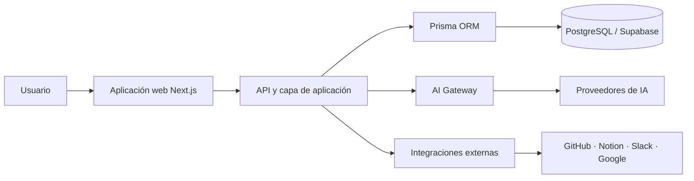

# Arquitectura de Meridian

> Documento público de alto nivel. No contiene secretos, credenciales, endpoints privados ni detalles que comprometan la seguridad del producto.

## Visión general

Meridian está diseñado como una plataforma SaaS B2B multi-tenant. La aplicación centraliza operaciones de negocio, productividad e inteligencia artificial en un solo entorno, manteniendo una separación estricta entre los espacios de trabajo.

## Capas principales

### 1. Experiencia de producto

- Dashboard y navegación del workspace.
- AI Workspace y conversaciones.
- CRM, tareas, calendario y notas.
- Analítica, miembros, Skills e integraciones.
- Configuración, consumo y suscripciones.

### 2. Capa de aplicación

Next.js gestiona la interfaz, las rutas de servidor y la lógica que conecta la experiencia del usuario con los servicios internos de Meridian.

### 3. Acceso a datos

Prisma funciona como ORM y capa tipada de acceso a PostgreSQL. Los modelos y consultas deben aplicar el contexto del workspace para evitar accesos cruzados entre organizaciones.

### 4. Persistencia

PostgreSQL, operado mediante Supabase, almacena los datos estructurados de la plataforma. La arquitectura está orientada a relaciones consistentes, migraciones controladas y consultas verificables.

### 5. AI Gateway

El AI Gateway desacopla Meridian de un único proveedor. Su función es seleccionar modelos, aplicar límites de uso, transportar contexto autorizado y normalizar respuestas sin otorgar acceso directo a secretos o bases de datos.

### 6. Integraciones

Las conexiones externas se implementan mediante OAuth, webhooks y APIs oficiales. Los tokens deben almacenarse cifrados y asociarse al workspace correspondiente.

## Principios de seguridad

- Separación estricta por `workspaceId`.
- Privilegios mínimos para usuarios, agentes e integraciones.
- Secretos únicamente en variables de entorno o almacenes protegidos.
- Validación de entradas y respuestas externas.
- Auditoría de operaciones sensibles.
- La IA opera mediante tools explícitas; no recibe acceso libre al código, billing o credenciales.

## Despliegue

La aplicación web se despliega en Vercel. PostgreSQL y servicios de datos se gestionan mediante Supabase. GitHub mantiene el control de versiones, revisión de cambios e integración continua.

---

**Propietario del producto:** Christian Junior de Jesús  
**Proyecto:** Meridian
